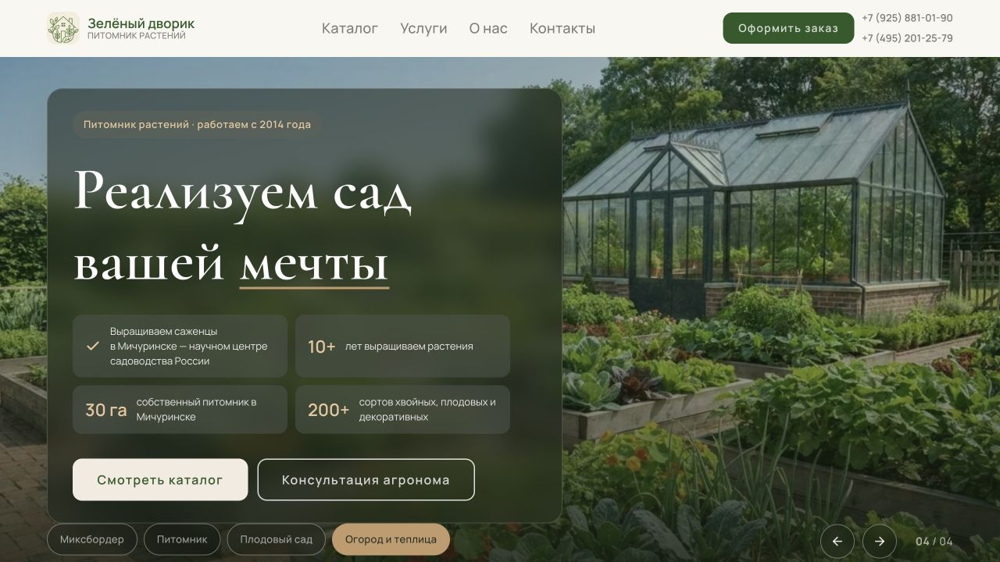

# PageSpeed: главная и две карточки — 12 октября 2026

## Проверка рабочего домена до изменений

Проверены мобильная и компьютерная версии через интерфейс PageSpeed Insights.
Google API без ключа возвращал 429, поэтому отчёты получены через браузер.
Полевых данных CrUX для этих страниц в отчётах нет.

| Страница и отчёт | Производительность: телефон / компьютер | Доступность | SEO |
|---|---:|---:|---:|
| [Главная](https://pagespeed.web.dev/analysis/https-green-courtyard-space/zdvwctw4rj?form_factor=mobile) | 81 / 97 | 92 | 100 |
| [Голубика Блюкроп](https://pagespeed.web.dev/analysis/https-green-courtyard-space-catalog-golubika-blyukrop/9ec33oqihw?form_factor=mobile) | 92 / 100 | 96 | 100 |
| [Абрикос Краснощекий](https://pagespeed.web.dev/analysis/https-green-courtyard-space-catalog-abrikos-krasnoschekiy/sy5or8vds5?form_factor=mobile) | 92 / 100 | 96 | 100 |

Главная: LCP 4,2 с на телефоне, ожидаемая экономия изображений 1336 КиБ,
блокирующих запросов — 1940 мс. У карточек LCP 2,7 с и замечания к внешней
таблице стилей Google Fonts, логотипу, контрасту и одинаковым названиям ссылок.
В компьютерном отчёте голубики один диагностический аудит задержки документа
вернул ошибку; остальные результаты получены. Это не подтверждает отказ сайта.

## Реализовано

1. Те же Manrope и Cormorant Garamond размещены на нашем сервере в WOFF2.
   Google Fonts CSS и внешние соединения убраны; используемые начертания и
   языковые наборы сохранены. Лицензии SIL OFL находятся в `fonts/`.
2. Стили и скрипты минифицированы; исходники остаются читаемыми.
   Шрифтовые объявления включены в общую таблицу стилей, добавлен preload.
3. Для фотографий главной добавлены адаптивные размеры и AVIF с WebP fallback.
   Исходные фотографии не заменены. У изображений заданы размеры и decoding.
4. Первое изображение слайдера имеет высокий приоритет. Подготавливается только
   следующий слайд, а фотографии ниже загружаются средствами браузера по мере
   приближения к экрану. Убрана принудительная загрузка всех ленивых фотографий.
5. Слайдер ждёт декодирования выбранного кадра и защищён от переключений,
   завершившихся в неправильном порядке при быстрых нажатиях.
6. Логотип для отображения 42×42 подготовлен в размере 84×84 WebP:
   27356 → 2530 байт. PNG для favicon сохранён.
7. Для двух проверенных товаров добавлены AVIF; у абрикоса есть вариант 720 px,
   чтобы телефон не скачивал изображение шириной 1000 px.
8. Подправлены контраст кнопки, активной вкладки слайдера, текста подвала и
   текста карточек. Увеличены области нажатия телефонов, добавлены понятные
   названия ссылок для программ чтения с экрана.
9. Обновлены генераторы карточек и подборок, ссылки на новые ресурсы и Docker.
   Расположение блоков и содержимое предложений сохранены.

## Повторная локальная проверка

Мобильный Lighthouse 13.5.0, эмуляция медленной сети, сервер Python на localhost.
Это **не новые оценки PageSpeed рабочего домена**. Локальный сервер отличается
от Nginx на VPS: протокол, сжатие, кеш и задержки сети различаются.

| Страница | Производительность до → после | Доступность до → после | LCP до → после | Загрузка до → после |
|---|---:|---:|---:|---:|
| Главная | 72 → 93 | 92 → 100 | 5,9 → 3,2 с | 2785 → 642 КиБ |
| Голубика Блюкроп | 99 → 98 | 96 → 100 | 1,7 → 2,3 с | 212 → 202 КиБ |
| Абрикос Краснощекий | 99 → 98 | 96 → 100 | 2,0 → 2,3 с | 262 → 224 КиБ |

На всех трёх страницах: SEO и рекомендации 100, CLS 0, ошибок консоли нет.
Главная существенно легче и быстрее в этом замере; ускорение карточек по LCP
локальные результаты не подтверждают. После выкладки нужно повторить PageSpeed
на тех же URL. Оценки одного запуска меняются и не гарантируют рост позиций.
Один промежуточный запуск главной с ошибкой локального сокета загрузки JS
исключён; итоговая проверка выполнена повторно с успешно загруженными ресурсами.

Числовые результаты: [measurements.json](reports/pagespeed-2026-10-12/measurements.json).

Дополнительно проверено:

- Слайдер, открытие формы и добавление/удаление товара в корзине.
- Главная и товар на ширине 375 px: фотографии загружаются, горизонтального
  переполнения нет, внешний вид проверен по снимкам.
- 343 страницы: нет ошибок SEO-проверки, все достижимы от главной.
- 28 тестов MAX, админки и маршрутов прошли.
- Docker-образ приложения собран; новые шрифты, стили, скрипты и AVIF внутри.

## Оставшиеся рекомендации

Общая таблица стилей содержит правила для разных страниц; удалять их ради
аудита unused CSS небезопасно для других разделов. Отдельная загрузка критических
стилей могла бы уменьшить блокирование, но требует более существенной переделки.
Некоторые изображения можно сжать сильнее ценой детализации. В текущем проходе
выбран умеренный уровень сжатия. Советы о кеше localhost не следует переносить
на VPS: Nginx уже задаёт длительное кеширование статики и gzip.
Trusted Types и усиление HSTS требуют отдельной проверки безопасности и доменов;
они не включены автоматически ради балла.

## Обновление и дальнейшая работа

На VPS в `~/GreenGarden`:

```bash
git pull --ff-only origin main
sudo bash deploy/update.sh --no-pull
```

После выкладки повторить мобильные и компьютерные отчёты PageSpeed.
Ресурсы имеют новые URL/версии для обновления кеша. MAX и настройки `.env`
в этом проходе не изменялись.

После правок CSS/JS: `python3 tools/build_frontend.py` (Node/npm только для
разработки; версия esbuild зафиксирована). После замены исходных фотографий:
`python3 tools/optimize_home_images.py` (libwebp/libavif). Обновлять версии
ресурсов при следующих выкладках. Хеш защиты главной обновлён под явно
разрешённые пользователем изменения этого прохода.




